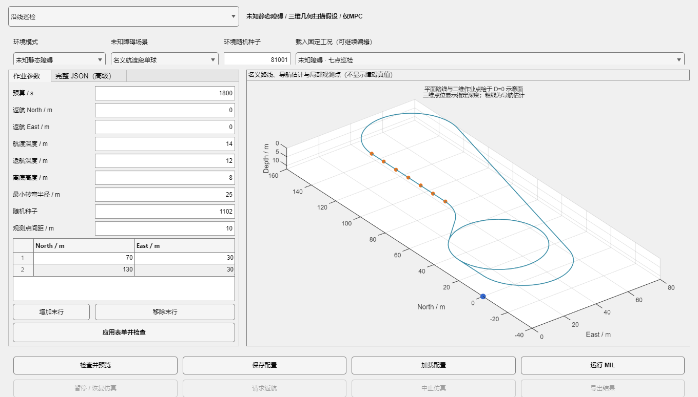
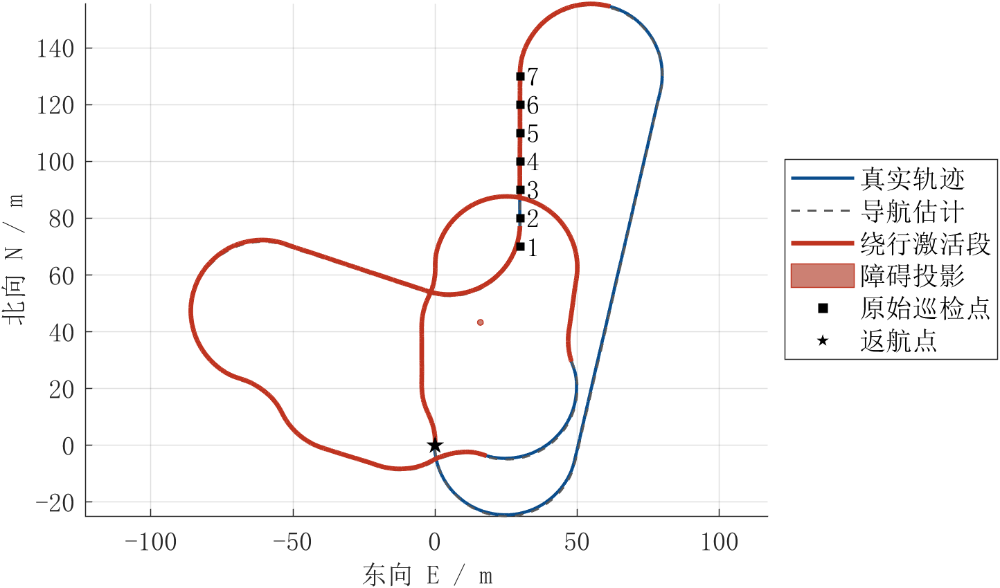

# 小型欠驱动AUV三维任务系统与多变量MPC

MATLAB课程设计：人工配置 → 可行性检查 → 自动规划 → MPC执行 → 作业确认 → 返航 → 结果导出。
当前模型为单推进器四舵、六自由度非线性物理对象，运动控制仅使用多变量约束MPC，包含执行器动态与导航估计反馈。



## 快速开始

使用MATLAB R2024b，安装并授权Control System Toolbox、Optimization Toolbox及Navigation Toolbox。
克隆仓库后将MATLAB当前文件夹设为仓库根目录，运行：
```matlab
START_HERE
```
工作台不依赖MCP、SolidWorks或AutoCAD，也不是独立EXE。请勿使用`addpath(genpath(...))`加入全部历史目录。
推荐预置“未知障碍·七点巡检”；检查配置后运行MIL。暂停只冻结仿真时间，中止并不等于实艇安全停车。

命令行复现最终巡检：
```matlab
cd mission_3d
addpath(pwd,fullfile(pwd,'planning'),fullfile(pwd,'perception'),fullfile(pwd,'baseline_v4','src'))
maxNumCompThreads(1)
r = run_static_case('inspection_transit',fullfile(pwd,'results','my_inspection'), ...
    'whole_ball_free_fusion','altitude_plane_nominal_v2');
```
输出目录必须不存在；后两个参数不可省略，否则会使用保留的历史默认策略。运行时间随硬件变化。

## 能力与验证范围

基础任务支持航渡、返航、多点访问、沿线巡检和区域巡测。未知静态障碍分支已完成下表固定工况。
导航采用惯性传播、DVL、压力及声明的航向辅助；GNSS用于前置对准，不提供水下连续定位。
规划仅使用观测地图和导航估计，包含水平与垂向候选；整艇包络参与检查，物理位置不直接由参考路线赋值。

| 固定工况 | 耗时/s | 确认 | 最小整艇障碍净距/m | 返航水平误差/m |
|---|---:|---:|---:|---:|
| 随机场82001 | 855.2 | 1/1 | 5.397 | 0.738 |
| 随机场82002 | 655.1 | 1/1 | 4.916 | 0.682 |
| 障碍墙自动上绕 | 842.5 | 1/1 | 6.200 | 0.639 |
| GUI七点巡检 | 1064.7 | 7/7 | 10.406 | 0.333 |



GUI巡检返航深度误差0.031707m，最大原始攻角12.345786°，QP失败0；9项独立审计通过。
GUI与对应原CLI归档的状态、估计和指令逐样本差为0。本机解压换目录后的22项接口检查通过。
这些是有限固定航次的MIL证据，不是随机成功率、全局规划完备性或实海安全保证；尚未在其他电脑完整验证。

## 文件说明

- `mission_3d/`：当前GUI、动力学、导航、制导、MPC、任务及静态避障源码。
- `mission_3d/evidence/`：固定航次、GUI和本机重定位检查的摘要JSON。
- `docs/mission_3d/`：控制结果图、工程边界与版本说明。
- `mechanical/`：整机及三张重要部位DWG、PDF预览和基本计算；完整SolidWorks依赖包单独保留。
- 原`src/`、`scripts/`、`models/`、`references/`及`reference_data/`为历史二维v1，不是当前三维任务实现。

## 重要边界

当前为静水及理想多仰角三维几何扫描假设下的MIL。60m扫描能力尚未落实到现有声呐机械占位件。
未完成动态障碍、HIL、实艇、真实水雷识别、电气布线与耐压水密实测；有限动作库可能拒绝实际可通行路线。
静态区域巡测和任意修改任务/种子不自动取得固定工况的验证资格。

## 历史与来源

历史`v1.0.0`保留MSS REMUS100二维路径跟随、PID与积分MPC v3及其Simulink验证。
当前三维对象是`auv6_*`工程模型，不是调用旧`remus100.m`，也没有将旧PID作为当前运动控制器。
完整说明见[版本变化](CHANGELOG.md)、[数据与提交材料](docs/mission_3d/ARTIFACTS.md)和[第三方来源](THIRD_PARTY_NOTICES.md)。
仓库保留历史integral-mpc名称；名称不意味着当前模型等同于旧二维积分MPC。
