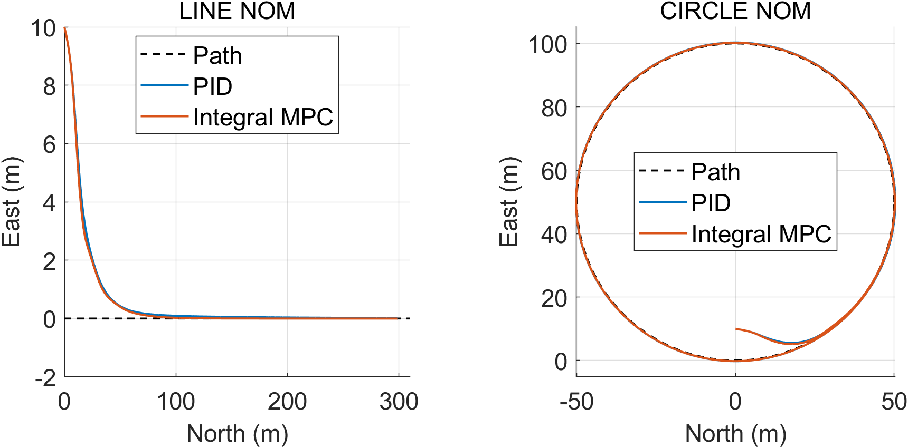
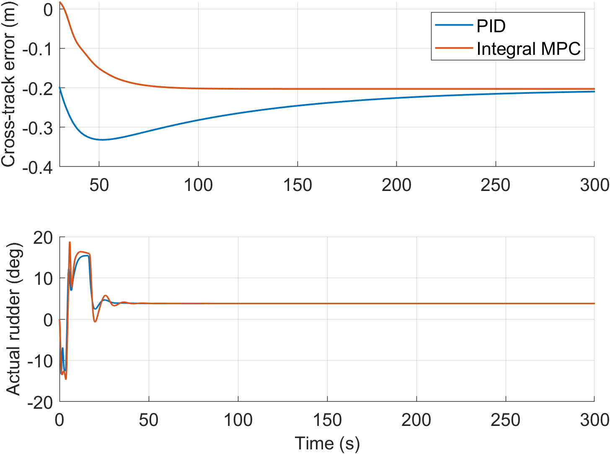

# 欠驱动 AUV 路径跟随：PID 与积分 MPC

基于 MSS REMUS100 六自由度动力学的水下机器人课程设计。提供冻结的 PID、改进积分 MPC v3、MATLAB 仿真、Simulink 闭环模型和可复现参考数据。

Underactuated AUV path following with a frozen PID baseline and integral MPC v3. Includes MATLAB/Simulink source, numeric reference trajectories and reproducibility checks.

本项目研究**路径跟随**：LOS 将直线或圆形路径转换为航向参考；MPC 优化方向舵指令，航速与深度采用共同的内环。并非完整机械设计或实艇试验。早期 MPC v1/v2 已废弃，本仓库仅发布最终 v3。

## 环境

- 已验证：MATLAB R2024b，Windows；其他版本未验证。
- 必需：Optimization Toolbox（`quadprog`、`lsqnonlin`）。
- 可选：Simulink，用于运行 `.slx` 与交叉验证；纯 MATLAB 仿真不需要 Simulink。
- MSS 所需 MATLAB 源码已随仓库提供，无需另外安装。保留其独立 MIT 许可。
- Python 3 仅用于可选静态检查，不参与控制仿真。

## 快速开始

```bash
git clone https://github.com/HakugyoMyon/auv-integral-mpc-course-design.git
cd auv-integral-mpc-course-design
git checkout v1.0.0
```

在 MATLAB 中将当前目录设为仓库根目录，执行：

```matlab
addpath(pwd, 'src', 'scripts', 'tests');
test_public_reproduction(false); % 短时 MATLAB 回归、配对噪声检查
run_design_comparison([1 2 11], true); % 三个代表工况，PID/MPC 共 6 次完整仿真
```

结果写入 `results/final_comparison_v3/`。代表子集运行返回 `in_progress` 表示尚未计算其余工况；不是仿真失败。只有 12 个工况的 24 次运行齐全后，才自动生成完整汇总表和图。

完整理想反馈对比：

```matlab
run_design_comparison(1:12, true);
```

Simulink：

```matlab
test_public_reproduction(true); % 另含 4 项短时 Simulink 交叉检查
open_simulink_v3;               % 打开闭环模型
run_simulink_v3_case(2, 2);     % 圆形；mode=1 为 PID，2 为 MPC
run_simulink_v3_validation;     % 全部 24 次交叉验证
```

传感器研究与全部实验：

```matlab
run_sensor_study_v3([1 2 11]); % 42 次：噪声、延迟、噪声+延迟
summarize_sensor_study_v3;
% 或从头运行全部实验（耗时取决于硬件）：
run_all(true); % MATLAB 对比 + Simulink 对比 + 传感器研究
```

`recompute=true` 会重新计算对应正式工况。若修改参数，旧缓存应另存或清理；与冻结参考的差异检查也应按新实验目的调整，不能将修改后结果继续称为 v3 复现。

## 模型与控制设置

- 非线性物理对象：MSS `remus100.m`，12 个刚体状态和 3 个执行器状态；RK4 步长 0.02 s，控制周期 0.1 s。
- 状态顺序：`[u v w p q r N E D phi theta psi rudder stern propellerRPM]`；NED 坐标，角度/角速度采用 rad/rad·s⁻¹，距离 m，速度 m/s。
- 航速 1.5 m/s，深度 10 m；圆半径 50 m；直线 200 s、圆形 300 s。
- LOS 前视距离 15 m，航向参考滤波时间常数 0.5 s，参考变化率上限 5°/s。
- MPC：六状态局部仿射预测模型 `[v p r phi psi actualRudder]`，预测步数 12、控制步数 10，航向积分权重 0.3。每次求解的预测区间内保持当前滤波航向参考；未使用完整 LOS 导数外推。
- 正常方向舵约束 ±20°、20°/s；严格工况 ±10°、5°/s。执行器一阶滞后和限速为课程设计假设，不是厂商测量值。
- PID 参数、速度/深度内环和工况统一冻结，未逐工况重新调参。全部具体值以 `src/current_control_parameters.m`、`src/auv_parameters.m` 和工况表为准。

## 已有结果与指标

以下为理想状态反馈下 `t >= 30 s` 的横向路径误差 RMSE（m）；舵 TV 为**全时段实际方向舵角相邻样本变化绝对值之和**（rad），不是舵角峰值或能耗。

| 工况 | PID RMSE / m | MPC RMSE / m | PID 舵 TV / rad | MPC 舵 TV / rad |
|---|---:|---:|---:|---:|
| 正常直线 | 0.128490 | 0.107671 | 1.292636 | 1.561340 |
| 正常圆形 | 0.254065 | 0.194581 | 1.405958 | 1.697766 |
| 严格舵约束直线 | 0.091243 | 0.020902 | 0.810437 | 1.208548 |

完整 12 个工况中，MPC 的 RMSE 均低于 PID，但理想反馈下舵 TV 均更大。误差和舵动作应同时评价，不能据此声称 MPC 在所有指标上更好。完整表见 [结果摘要](docs/results/pid_mpc_v3_pairs.csv)。





原工程完成 24 次 MATLAB 正式仿真、24 次 Simulink 交叉验证和 42 次传感器实验，最终 QP 失败数均为零。Simulink 与 MATLAB 使用同一控制核心，交叉验证检验的是实现一致性，并非独立证明模型真实性。

发布包另行通过：10 项 2 s MATLAB 冻结轨迹检查、配对噪声检查、4 项 2 s Simulink 检查，以及上述三工况共 6 次完整仿真；6 次完整轨迹与冻结数据的最大状态差为 0。历史全量结果位于 `docs/results/`，本地新运行结果位于 `results/`。

## 目录

| 路径 | 内容 |
|---|---|
| `src/` | 冻结控制核心、动力学包装、制导、指标及实验入口 |
| `models/` | Simulink 闭环 `.slx` 模型 |
| `scripts/`、`tests/` | 全流程入口、数据导出、静态检查和复现测试 |
| `reference_data/v3/` | 24 份精简数值参考轨迹，供逐样本回归 |
| `docs/design/` | 12 工况参数矩阵 |
| `docs/results/`、`docs/figures/` | 已完成实验的汇总数据和自绘图 |
| `references/code/MSS/` | 固定版本 MSS MATLAB 源码及原许可证 |

进一步说明见 [复现与验证边界](docs/reproduction.md) 和 [参考数据格式](reference_data/README.md)。

## 来源、适用边界与许可

MSS 上游：Thor I. Fossen 等维护的 [Marine Systems Simulator](https://github.com/cybergalactic/MSS)。固定源码提交为 `ed2ce7b4d8f44e3a724972499d8b5cd6189afc0e`，这是标识特定源码版本的 Git 指纹，用于避免上游更新改变结果。逐文件校验值见 `reference_data/source_manifest.json`。

仓库自己的代码按 MIT 许可发布，MSS 保留独立 MIT 版权声明，详见 [第三方说明](THIRD_PARTY_NOTICES.md)。模型不是 REMUS 厂商验证模型；原源码中的流场转换和部分耦合项近似仍然存在。执行器参数与传感器噪声均属于仿真假设。当前没有实艇验证、状态估计器或全局闭环稳定性证明；圆形仍有稳态偏差，严格舵约束圆形存在较慢捕获。传感器研究目前只在 MATLAB 中实现，不能将其结果当作 Simulink 噪声实验。

## 在报告中引用

建议引用固定版本 **v1.0.0**，同时在动力学模型来源处单独引用 MSS：

> HakugyoMyon. Underactuated AUV Path Following with PID and Integral MPC: v1.0.0 [CP/OL]. 2026. https://github.com/HakugyoMyon/auv-integral-mpc-course-design/tree/v1.0.0.

也可使用仓库的 `CITATION.cff`。本仓库提供课程设计的源码与复现材料，不包含个人课程报告、文献 PDF 或第三方实艇照片。
