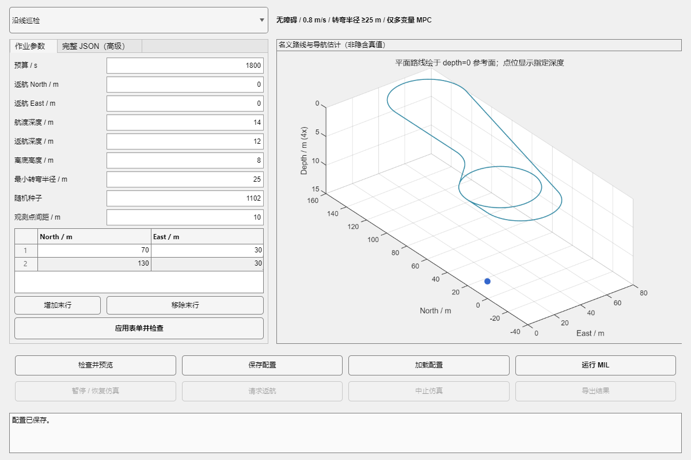

# AUV 基础任务系统：人工配置与多变量 MPC 闭环

课程项目，俞承志，水下机器人技术。本包已通过五类固定种子完整MIL航次、载荷失效后的补巡返航、命名边界拒绝及配置界面检查；原始证据另见阶段目录，数据摘要见docs/验收摘要.json。

这是三维六自由度 AUV 的模型在环（MIL）系统：人工任务输入 → 参数/能力及名义几何检查 → 曲率和垂向时间规划 → INS/DVL/深度/航向组合导航 → 多变量 MPC → 推力及四舵执行器动态 → 作业确认与账本 → 补巡/返航 → 原始记录和结果导出。控制器不读取仿真真值，不使用 PID。

## 启动

在 MATLAB 中进入本文件所在目录，运行：

```matlab
start_task_system
```

只使用当前 MATLAB，不需要 MCP、额外 MATLAB 实例、SolidWorks 或 AutoCAD。依赖 MATLAB R2024b、Control System Toolbox、Optimization Toolbox 和 Navigation Toolbox；需要相应的本地安装及许可证。

也可以从脚本运行，无需打开工作台：

```matlab
report = run_mission('visit');
```

支持的名称为 `survey`、`inspection`、`visit`、`transit`、`return`。默认输出到本目录下按时间新建的 `results` 子目录，已有原始记录不会被覆盖。

## 配置作业



图为最终版本实际加载巡检配置并保存后的界面。路线绘于参考平面，不能把它理解为已知海底深度。

| 类型 | 用户主要输入 | 机载确认规则 | 终点 |
|---|---|---|---|
| 区域巡测 survey | 区域中心/长宽/方向、最大线距、覆盖率、离底高度 | 网格内有效几何观测达到支持次数，覆盖比例满足要求 | 家点 |
| 沿线巡检 inspection | 设施北/东折线、观测点间距、离底高度 | 原始设施点的有效几何观测达到支持次数 | 家点 |
| 三维点位 visit | 北/东/深度与优先级点表 | 位置置信界和深度置信界满足到达容差 | 家点 |
| 航渡 transit | 单个北/东/深度目标 | 目标置信到达 | 指定目标，不声称返航 |
| 返航 return | 家点北/东、返航深度 | 家点置信到达 | 家点 |

基本页提供带单位的数值表单，可增删访点/设施折线末行。修改后点击“应用表单并检查”；未应用的改动会阻止运行。高级 JSON 页可以编辑完整参数，修改后重新同步表单。配置支持保存与加载；保存须选择新文件。

位置使用本地 NED，单位m，深度向下为正。基本表单的区域方向为deg，JSON中的角度为rad。初始导航对准固定于局部原点、航向0。

预检检查图幅、转弯半径、时间、传感器几何与参考深度变化时间，不是六自由度可行性、能量预算或任务成功保证。实际执行仍逐步检查导航、MPC、非线性预测和执行器条件。

## 改写一个任务

```matlab
addpath(fullfile(pwd,'src'));
cfg = auv_task_load(fullfile('missions','visit.json'));
cfg.task.visit.pointsNED = [60 20 15; 110 50 16; 90 90 13];
cfg.task.visit.priority = [1; 2; 1];
[check, plan] = auv_task_validate(cfg);
assert(check.valid, strjoin(check.errors));
disp(plan.geometricETA_s)
report = run_mission(cfg);       % 与工作台使用同一个执行器
```

在启动阶段只想检查运行链时，可显式缩短仿真时长：

```matlab
report = run_mission('transit', fullfile(pwd,'results','short_check'), 2);
```

2s不能完成航渡，该例应报告 `time_horizon_reached`、任务未通过；短检查不替代完整任务验证。

## 暂停、中止与人工返航

- 暂停/恢复：冻结/恢复仿真时间，不代表实体 AUV 悬停。
- 中止：结束MIL并保存未完成状态，不代表实体机器人安全停车或安全退出。
- 人工返航：从当前导航估计状态重新规划，使用当前执行器模型状态和MPC记忆，经新一轮MPC准入后切换。原始任务ID和已完成成果保留，接受返航后不再继续累计原作业成果。
- 提前返航成功和原任务完成是两个字段。未完成作业不会因为回到家点自动变为完成。
- 在未被人工取消的正常作业中，返航发现漏项会尝试重新安排剩余点，账本保留原ID；有限候选搜索失败或时间不足会明确失败，不承诺任意任务总能完成。

## 导出与审计

原始 `mil.mat` 保存状态、传感器包、导航协方差、MPC/执行器目标、实际运动、任务账本、准入记录和路线交接。结果目录同时有 `report.json`。

结束后点击“导出结果”，或运行：

```matlab
auv_task_export(fullfile('results','某个航次','mil.mat'), ...
                fullfile('results','新的导出目录'));
```

导出包括任务输入、摘要、轨迹、执行器、原始目标ID及支持次数、人工命令和路线变更。CSV里的truth列明确为离线仿真证据，不是控制输入。失败/中止记录也能导出，导出不改变成功判定。

需要重放审计时，在 `src` 已加入路径的情况下运行：

```matlab
file = fullfile('results','某个航次','mil.mat');
s = load(file,'plan');
if auv_task_is_point_task(s.plan.task.type)
    auv_task_audit_visit(file);
else
    auv_task_audit_payload(file);
end
d16_actuator_audit(file);
d11_audit_heading_run(file);
d11_audit_heading_innovations(file);
auv_task_replay_control(file);
```

这些分别检查原ID账本/观测支持、执行器、导航及传感器一致性、制导/MPC/物理重放。重放使用记录的导航和路线输入，不应冒充新的独立随机航次；随附的最终回归另外重新执行完整航次。

## 当前能力与边界

固定0.8m/s控制分支；规划转弯半径25～200m，参考深度变化率不超过0.06m/s。访点到达水平容差最多3m、深度最多0.5m，并扣除导航置信界。区域最多2000网格、最多100条航线；沿线最多50个折线顶点、2000个观测点；访点最多50个。启动要求可用内存超过1.5GB，预分配另按数据量检查，运行门槛0.75GB。

巡测/巡检采用显式公开的作业深度范围 `depth.workDepthBounds_m`，预设为[4,24]m。规划使用0.85m/s速度上界和5s参考变深余量，必要时增加前向整圆机动；这不是悬停。高度控制仍依赖实时高度计，高度换算的目标深度越过声明范围会中止。路线显示在depth=0参考面，指定点显示其深度，纵向绘图比例明确为4倍。

目前仅在明确无障碍、静水、完全浸没的课程环境验证。避障成果冻结，未接入本基础任务包。作业载荷是几何观测模型，不是实测声呐成像、缺陷识别或真实采样。初始使用独立对准传感器fixture和水下配平状态，不包含水面起航下潜全过程。终点为前向穿越确认，不是停车、停靠、上浮回收或HIL/实艇测试。

可选故障窗口位于 `execution`：`payloadUnavailableWindows_s`、`dvlUnavailableWindows_s`、`altimeterUnavailableWindows_s`，每行是以秒计的[start,end)，最多20行。传感器正常生成后再屏蔽以保持随机流，故障测试会保留原包和配置；这不代表真实硬件故障复现。

源码和数据来源见 `THIRD_PARTY_NOTICES.md`；源文件哈希及工具箱识别见 `PACKAGE_MANIFEST.json`。原始单航次报告中的“候选、需审计”scope是运行时固定说明，最终资格须结合随附独立回归和审计结果判断。

真实作业任务原型及公开来源见[任务原型与来源](docs/任务原型与来源.md)。本工程仅借鉴作业组织与有效观测判据，不继承产品成像性能或论文规划算法。
